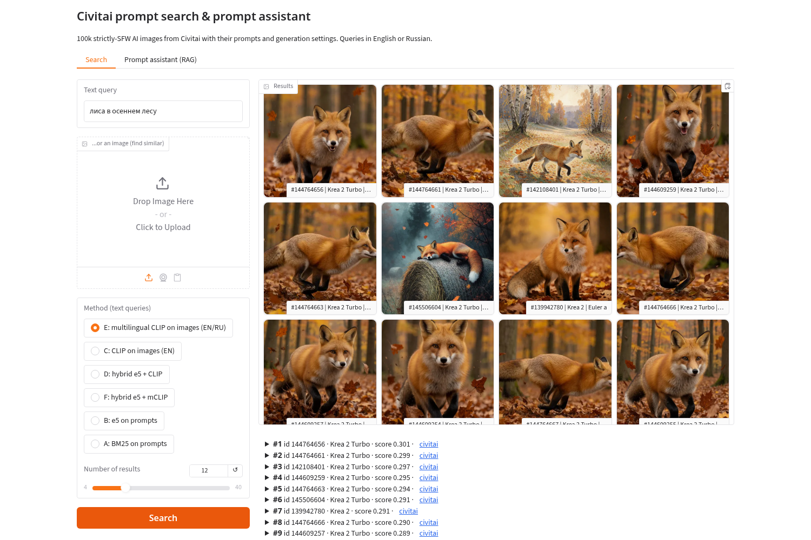
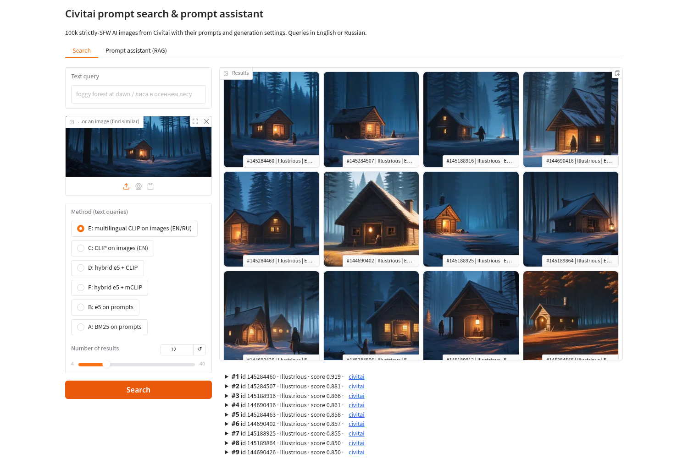
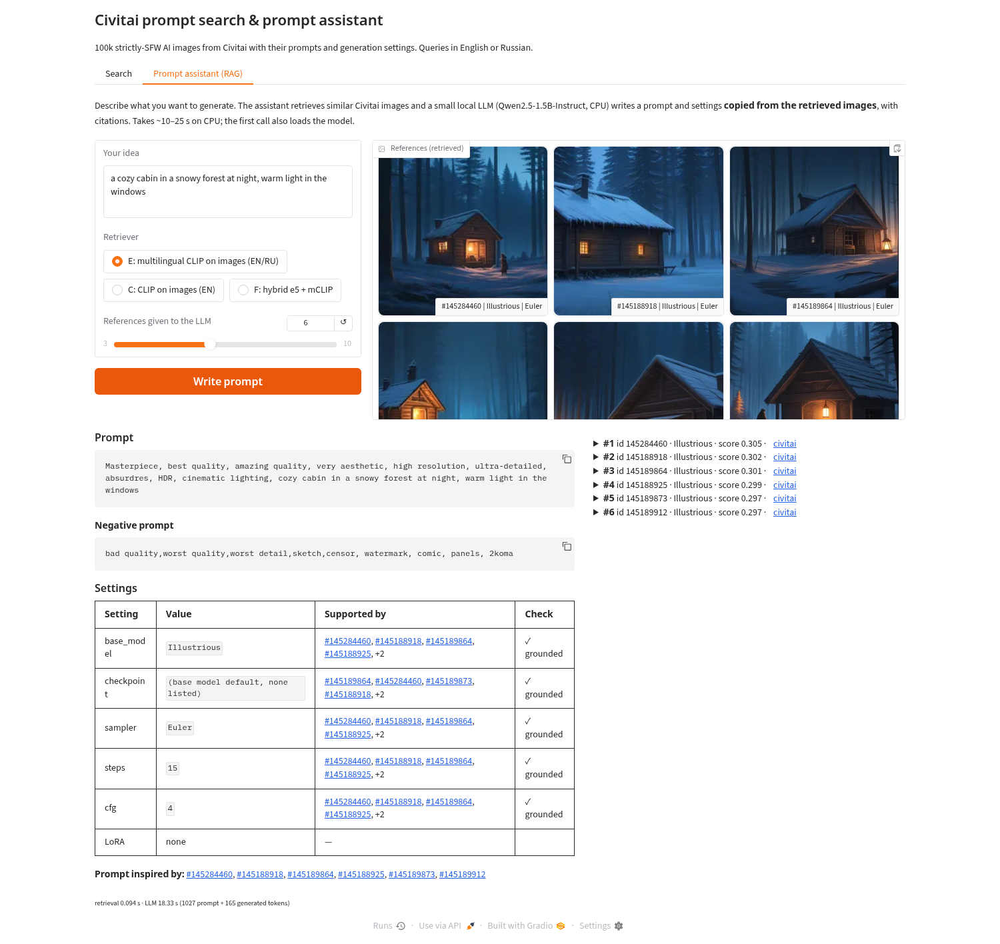
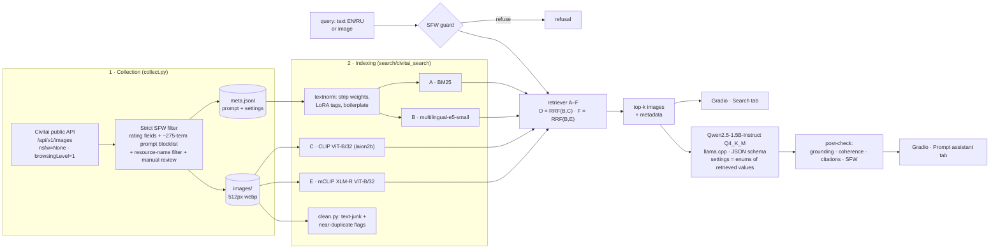

# Civitai Prompt Search & RAG Prompt Assistant

Multimodal retrieval over **100,167 strictly-SFW AI-generated images from Civitai** with their real prompts and
generation settings, plus a **retrieval-augmented prompt assistant** that runs fully on CPU with a small local LLM.

* **Search:** type a text query in English or Russian, or upload an image. You get similar generations with
  prompt, negative prompt, model, sampler, steps, CFG, seed, LoRAs and a link to the Civitai page.
  It answers "how was an image like this made?".
* **Prompt assistant (RAG):** describe an idea, for example *"киберпанк-город под дождём, аниме"*. The system
  retrieves the most similar images. Then **Qwen2.5-1.5B-Instruct** (GGUF, llama.cpp, CPU) writes a ready-to-use
  prompt and picks a base model, sampler, steps, CFG and LoRAs. Every setting is copied from the retrieved images
  and cited by image id; nothing is invented.
* **Evaluation:** six retrieval methods are compared on one corpus. Text→image uses P@10, nDCG@10 and MRR on
  100 EN/RU queries. Prompt self-retrieval uses Recall@K. Image→image uses robustness tests. Generation is scored
  on groundedness, CLIP similarity and latency.

| Text search (RU query → mCLIP) | Image search (upload → similar images) | Prompt assistant (RAG) |
|---|---|---|
|  |  |  |

> **Licensing.** The images and prompts belong to their authors on Civitai. **This repository ships code and the
> collection scripts only, with no images and no metadata dump.** You can rebuild the corpus with `collect.py`
> through the public Civitai API.

---

## Architecture



## Dataset

| | |
|---|---|
| Images | **100,167** (97,993 indexed after removing 226 text-only banners and 1,963 near-duplicates; flagged rows are kept on disk but excluded from search) |
| Authors | 8,157 (per-author cap during collection; max 727 images per author) |
| Base models | Krea 2 41,039 · Illustrious 33,000 · Flux (.1/.2/.3 variants) 17,000 · Z Image 2,767 · SDXL 2,500 · Anima 2,500 · Pony 1,000 · MOSS Image 361 |
| Size | 4.9 GB of 512-px webp images; embeddings 98 + 98 + 73 MB (fp16) |
| Created | mostly Sep–Oct 2026 (popular streams; range 2023-08 … 2026-10) |
| Metadata completeness | prompt 100% · steps 96% · CFG 95% · seed 95% · sampler 92% · checkpoint name 51% · negative prompt 50% · LoRAs 25% · ComfyUI workflow 12% |

The initial quotas were 50k Krea 2, 33k Illustrious and 17k Flux. Krea 2 ran out at 41k: the API had no more SFW
images with prompts. The shortfall was filled with five other recent, popular, good-quality base models, and none of
them makes up more than 3% of the corpus. SD 1.5 and video models were skipped.

### Strict SFW filtering

The corpus is meant to be safe for a public portfolio project, so filtering errs on the side of dropping images:

1. **API level:** `nsfw=None`, `browsingLevel=1`.
2. **Record level:** keep only `nsfwLevel == "None"`, `browsingLevel == 1`, `nsfw == false`. All 100,167 records
   pass this check.
3. **Prompt blocklist** (positive prompt only, since negative prompts usually *contain* "nsfw, nude"): about 275
   terms covering nudity, underwear and swimwear, suggestive outfits and poses, fetish terms, gore, and
   minor-related words. The list was extended four times after looking at random sample grids. For example, a
   "giantess / feet" cluster found in the 100k review removed about 490 more images.
4. **Resource names:** checkpoints and LoRAs whose names contain *uncensored, nsfw, filter bypass, …* are rejected.
5. **Manual review:** contact sheets of random samples for every base model; borderline ids go to `manual_remove.txt`.
6. **At query time** ([`safety.py`](search/civitai_search/safety.py)): the same blocklist (whole-word matching plus
   Russian stems) refuses NSFW queries in Search and in the assistant. LLM output is sanitized, and LoRAs with
   unsafe names are never recommended.

The blocklist is deliberately over-inclusive, so some harmless queries are refused ("kid with a balloon",
"bloody mary cocktail").

## Retrieval methods

| | Method | Indexes | Query languages |
|---|---|---|---|
| A | BM25 (own sparse implementation) | cleaned prompt text | whatever language the prompts are in (mostly EN) |
| B | `intfloat/multilingual-e5-small` + FAISS | cleaned prompt embeddings | EN, partly RU |
| C | CLIP `ViT-B-32 / laion2b_s34b_b79k` + FAISS | **image pixels** | EN; also image→image |
| D | RRF(B, C) | hybrid | |
| E | multilingual CLIP `xlm-roberta-base-ViT-B-32 / laion5b_s13b_b90k` | **image pixels** | EN + RU (+ other XLM-R languages) |
| F | RRF(B, E) | hybrid | |

All indexes are exact (FAISS `IndexFlatIP`). At 98k vectors that takes a few ms, so no ANN is needed.

## Prompt assistant (generation step)

[`generate.py`](search/civitai_search/generate.py):

1. The **SFW guard** checks the idea first.
2. **Retrieve** the k=6 nearest images with method E (works for EN and RU ideas).
3. The **LLM** sees each reference as `[#id] base_model | checkpoint | sampler | steps | cfg | loras` plus a
   truncated prompt and negative prompt. It must answer in JSON (prompt, negative prompt, base model, checkpoint,
   sampler, steps, CFG, LoRAs, source ids).
4. **Constrained decoding:** the JSON schema passed to llama.cpp turns every setting into an *enum of the values that
   occur in the retrieved references*. The model physically cannot emit a sampler or LoRA it did not see. A `free`
   mode with plain types is kept for the evaluation.
5. **Post-check:** each value is looked up in the references.
   * A value is *grounded* if some reference has it.
   * It is *coherent* if a reference **with the recommended base model** has it. This stops recipes like
     "Illustrious + 8 steps CFG 1 from a Krea Turbo image".
   * Anything else is replaced by the rank-weighted majority value of the coherent references and marked
     "↺ corrected".
   * Each final value is shown with the ids that support it. Invalid citations are dropped.
6. **SFW sanitize** of the generated prompt. Repeated tags (a common failure of small LLMs) are removed as well.

**LLM choice.** Qwen2.5-1.5B-Instruct, Q4_K_M GGUF (1.1 GB), run with `llama-cpp-python` on 8 CPU threads.
I benchmarked it against Qwen2.5-3B-Instruct Q4_K_M on the same prompt (about 1,000 context tokens):
1.5B took 13 s and 3B took 26 s (on the 26-idea evaluation below: p50 11.2 s vs 19.0 s). Only 1.5B stays well under the 30 s target with room for longer contexts, and it
uses about 1.5 GB of RAM next to the 4.5 GB of retrievers. Qwen2.5 was picked because it follows JSON instructions
reliably at this size, handles Russian input, has official GGUF builds, and has no "thinking" mode that would waste
tokens on CPU. The 3B model is still supported (`--gguf`), and the evaluation below compares the two.

## Results

All numbers come from the 100k corpus on CPU (8 vCPU Xeon, no GPU). Raw outputs are in
`search/artifacts/eval/`, and every table can be reproduced with the commands in [How to run](#how-to-run).

### Text → image (100 queries: 50 EN + 50 RU, pooled binary relevance)

The query set (`search/eval/queries_100k.json`) has 30 EN + 10 RU queries from the first iteration, plus 20 new EN
queries, 20 RU translations of EN queries (parallel pairs) and 20 new RU queries. For each query, every image
returned by any method in its top-10 is judged once (3,420 judgments), so all methods are scored on the same pool.

| P@10 / nDCG@10 / MRR@10 | A BM25 | B e5 | C CLIP | D B+C | E mCLIP | F B+E |
|---|---|---|---|---|---|---|
| **EN** (50) | 0.59 / 0.62 / 0.82 | 0.58 / 0.63 / 0.84 | **0.82 / 0.85 / 0.95** | 0.77 / 0.80 / 0.92 | 0.81 / 0.83 / 0.93 | 0.77 / 0.80 / 0.93 |
| **RU** (50) | 0.02 / 0.02 / 0.08 | 0.13 / 0.14 / 0.24 | 0.01 / 0.01 / 0.02 | 0.08 / 0.09 / 0.18 | **0.75 / 0.85 / 0.91** | 0.51 / 0.57 / 0.75 |
| **All** (100) | 0.30 / 0.32 / 0.45 | 0.36 / 0.38 / 0.54 | 0.42 / 0.43 / 0.48 | 0.43 / 0.45 / 0.55 | **0.78 / 0.84 / 0.92** | 0.64 / 0.69 / 0.84 |

On the 20 parallel EN/RU pairs (same query in both languages), E reaches P@10 0.92 in English and 0.82 in Russian.
C drops from 0.94 to 0.01, and B from 0.60 to 0.17.

### Prompt self-retrieval Recall@K (automatic, no labels)

1,000 random indexed images (seed 0) are turned into queries made from a *degraded* version of their own prompt.
We check whether the image itself is found. A *lenient* hit also counts any image with an identical cleaned
prompt (authors post series with the same prompt).

| Query variant (n) | metric | A BM25 | B e5 | C CLIP | D B+C | E mCLIP | F B+E |
|---|---|---|---|---|---|---|---|
| first 10 words (1000) | R@1 | **0.60** | 0.51 | 0.07 | 0.30 | 0.09 | 0.28 |
| first 10 words (1000) | R@10 | **0.88** | 0.80 | 0.20 | 0.72 | 0.20 | 0.72 |
| first 10 words (1000) | R@100 | **0.98** | 0.94 | 0.36 | 0.91 | 0.36 | 0.91 |
| first 10 words (1000) | R@10 lenient | **0.90** | 0.82 | 0.23 | 0.77 | 0.23 | 0.76 |
| 50% of content words, shuffled (1000) | R@1 | **0.82** | 0.71 | 0.15 | 0.48 | 0.14 | 0.48 |
| 50% of content words, shuffled (1000) | R@10 | **0.98** | 0.94 | 0.34 | 0.91 | 0.35 | 0.91 |
| 50% of content words, shuffled (1000) | R@100 | **1.00** | 0.99 | 0.58 | 0.98 | 0.58 | 0.98 |
| 50% of content words, shuffled (1000) | R@10 lenient | **0.99** | 0.95 | 0.38 | 0.94 | 0.40 | 0.94 |
| LLM paraphrase ≤20 words (300) | R@1 | **0.76** | 0.53 | 0.30 | 0.56 | 0.30 | 0.56 |
| LLM paraphrase ≤20 words (300) | R@10 | **0.94** | 0.81 | 0.60 | 0.84 | 0.61 | 0.86 |
| LLM paraphrase ≤20 words (300) | R@100 | **0.97** | 0.94 | 0.79 | 0.97 | 0.78 | 0.97 |
| LLM paraphrase ≤20 words (300) | R@10 lenient | **0.96** | 0.82 | 0.64 | 0.90 | 0.63 | 0.90 |

This metric **favours prompt-based methods by construction** (A and B index the same text the query comes from),
so it complements P@10 and does not rank methods on its own. It shows that BM25 and e5 are excellent at *finding a
known prompt*, while CLIP/mCLIP (which see only pixels) recover the exact image from a 10-word fragment only about
20% of the time. That is still a reasonable result given about 98k candidates and the many visually similar series.
The hybrids D and F recover most of B's recall while keeping CLIP's visual relevance. The paraphrases come from the
same 1.5B LLM and often keep the original wording, which inflates A.

### Image → image robustness (300 corpus images, distorted copy as query, method C)

| Distortion | R@1 | R@5 | R@10 | (30k corpus R@1 / R@10) |
|---|---|---|---|---|
| crop 50–80% of side | 0.84 | 0.95 | 0.98 | 0.89 / 0.98 |
| downscale ×4 → upscale | 0.97 | 1.00 | 1.00 | 0.99 / 1.00 |
| color jitter | 1.00 | 1.00 | 1.00 | 1.00 / 1.00 |
| JPEG q=20 | 0.99 | 1.00 | 1.00 | 1.00 / 1.00 |
| all combined | 0.55 | 0.67 | 0.72 | 0.64 / 0.85 |

The combined-distortion case dropped from 30k to 100k images: a heavily distorted copy has more look-alike
neighbours in a 3× larger corpus, especially among near-identical series. This is a hypothesis and has not been
tested separately.

### Generation (26 ideas: 13 EN + 13 RU, retriever E, k = 6)

| Metric | 1.5B constrained | 1.5B free | 3B constrained |
|---|---|---|---|
| answered / valid JSON | 26/26 · 1.00 | 26/26 · 1.00 | 26/26 · 1.00 |
| grounded@raw | 1.000 | 0.969 | 1.000 |
| coherent@raw | 0.923 | 0.923 | 0.908 |
| grounded@final | 1.000 | 1.000 | 1.000 |
| items corrected per answer | 0.385 | 0.385 | 0.462 |
| valid citations | 1.000 | 0.962 | 1.000 |
| CLIP(gen. prompt, idea) | 0.706 | 0.706 | 0.718 |
| ↳ baseline: CLIP(top-1 ref. prompt, idea) | 0.604 | 0.604 | 0.604 |
| CLIP(gen. prompt, ref. images) | 0.273 | 0.273 | 0.279 |
| ↳ baseline: CLIP(idea, ref. images) | 0.287 | 0.287 | 0.287 |
| latency p50 / p95, s | 11.2 / 16.2 | 12.0 / 14.5 | 19.0 / 28.7 |
| tokens in / out (mean) | 1107 / 139 | 1107 / 140 | 1107 / 147 |
| blocked terms removed from output | 0 | 0 | 1 |
| SFW refusal probes (EN/RU, 5) | 5/5 refused | – | – |

* **grounded@raw** is the share of recommended items (base model, checkpoint, sampler, steps, CFG, each LoRA) whose
  *raw* LLM value occurs in some retrieved reference. **coherent@raw** requires it to occur in a reference with the
  recommended base model.
* **grounded@final** is the same check after the post-check. It is 1.0 by construction, because every shown value
  comes with supporting image ids.
* **CLIP sims** use mCLIP (multilingual): the generated prompt is compared with the idea text and with the
  reference images. Baselines are the top-1 reference's own prompt vs the idea, and the idea vs the references.

Outputs for manual review are in `search/artifacts/eval/generation_review_*.md`, and an empty 1–5 rating sheet is in
`generation_rating_*.csv`. Constrained and free mode give almost the same answers here (greedy decoding, same prompt); the difference is that in free mode the 1.5B model emitted 3% ungrounded values (e.g. a sampler or step count not present in any reference), which the post-check then replaced. The 3B model writes slightly closer prompts (CLIP 0.718 vs 0.706) at 1.6× the latency, so 1.5B stays the default. In both models the generated prompt is closer to the idea than the best retrieved prompt (0.71 vs 0.60), i.e. the LLM adapts the references to the idea instead of copying them. Typical failures seen in the review file: leftover trigger words or author tags copied from references (`IllusP0s`, `@himmis`, `Generation Mode: … Positive Prompt:`), occasional invented details ("lush green grass of Mars" for a space station), and the over-inclusive blocklist removing harmless words (`wet` in "rain-wet streets"). Manual 1–5 ratings have not been done yet.

### Latency and size

| | p50 | p95 |
|---|---|---|
| A BM25 text query | 0.9 ms | 1.1 ms |
| B e5 text query (incl. encoding) | 22 ms | 48 ms |
| C CLIP text query | 33 ms | 54 ms |
| D RRF(B,C) | 52 ms | 76 ms |
| E mCLIP text query | 45 ms | 62 ms |
| F RRF(B,E) | 66 ms | 87 ms |
| image query (C / E, incl. encoding) | 36 / 33 ms | 45 / 47 ms |
| prompt assistant, end-to-end (1.5B) | 11.2 s | 16.2 s |

| Index | vectors | dim | FAISS fp32 | .npy fp16 |
|---|---|---|---|---|
| A BM25 | 97,993 docs, 127,812 terms, 4.9M postings | – | 37.5 MB (sparse) | – |
| B e5 | 97,993 | 384 | 144 MB | 73 MB |
| C CLIP | 97,993 | 512 | 191 MB | 98 MB |
| E mCLIP | 97,993 | 512 | 191 MB | 98 MB |

Embedding throughput on CPU: CLIP 74–88 img/s (about 20 min per 100k), mCLIP 86–97 img/s, e5 about 81 prompts/s.
The app with all six retrievers and the LLM loaded uses about 6 GB of RAM, and a cold start takes about 60 s.

## Observations

* **Pixels beat prompts for visual attributes.** CLIP and mCLIP win on style, colour, lighting and composition
  ("pixel art", "black and white", "watercolor", "pink hair"), where the prompt is silent or misleading.
* **Prompts beat pixels for known wording.** BM25 and e5 find an image from fragments of its prompt, but they
  return long series of near-identical images from one author.
* **Russian needs a multilingual image encoder.** Prompts are about 99% English, so text methods and English CLIP
  fail on Russian, while mCLIP loses only about 0.1 P@10 compared with English.
* **Naive RRF hurts when one component is weak** (D < C, F < E). Language routing (E for RU, C for EN) or weighted
  fusion would be better.
* **Small LLM, strong guard rails.** With constrained decoding and the post-check, the 1.5B model never shows an
  invented setting. Its prompts are fluent but sometimes generic, or they mix tag style and prose (see the review file).

## How to run

```bash
# 0. environment (CPU-only torch)
cd search
python -m venv .venv && . .venv/bin/activate
pip install -r requirements.txt --extra-index-url https://download.pytorch.org/whl/cpu \
    --extra-index-url https://abetlen.github.io/llama-cpp-python/whl/cpu

# 1. collect the corpus (strict SFW; resumable; writes ../meta.jsonl and ../images/)
python ../collect.py                       # quotas per base-model family, see FAMILIES in collect.py
export CIVITAI_DATA_DIR=..                 # folder with meta.jsonl + images/

# 2. embeddings + cleaning
python -m civitai_search.build_embeddings --what clip    # ~20 min / 100k on 8 vCPU
python -m civitai_search.build_embeddings --what mclip   # ~18 min
python -m civitai_search.build_embeddings --what text    # ~20 min
python -m civitai_search.clean                           # junk + near-duplicate flags

# 3. demo (Search + Prompt assistant tabs); the GGUF model is downloaded on first use
python -m civitai_search.app --port 7860
python -m civitai_search.generate "лиса в осеннем лесу, акварель"     # CLI version of the assistant

# 4. evaluation
python -m civitai_search.eval_text2img run       # top-10 for A-F on 100 queries + latency + label sheet
python -m civitai_search.import_labels           # prelim_labels_raw.txt -> qrels_prelim.csv
python -m civitai_search.eval_text2img score     # P@10 / nDCG@10 / MRR (+ --qrels eval/qrels_user.csv)
python -m civitai_search.labeler                 # relabel yourself; then: eval_text2img agree
python -m civitai_search.eval_selfretrieval paraphrase && python -m civitai_search.eval_selfretrieval run
python -m civitai_search.eval_img2img            # image->image robustness
python -m civitai_search.eval_generation         # generation metrics (1.5B, constrained + free)
python -m civitai_search.bench                   # index sizes, image-query latency
python -m civitai_search.dataset_stats
```

Environment variables: `CIVITAI_DATA_DIR`, `CIVITAI_ART_DIR` (artifacts), `LLM_GGUF` (local GGUF path) or
`LLM_REPO`/`LLM_FILE`, `LLM_THREADS`.

## Repository layout

```
collect.py                 Civitai collector: quotas per base-model family, SFW filters, resumable state
search/
  civitai_search/
    config.py              paths, model names, LLM settings
    data.py                meta.jsonl loader (row order = embedding order), model families
    textnorm.py            prompt cleaning (weights, LoRA tags, boilerplate, generator dumps)
    safety.py              strict-SFW guard for queries, LLM output and resource names
    encoders.py            CLIP / mCLIP / e5 wrappers
    build_embeddings.py    resumable, chunked embedding builder (fp16 .npy)
    clean.py               text-junk and near-duplicate flags (never deletes)
    retrieval.py           methods A–F
    generate.py            RAG prompt assistant (llama.cpp, schema-constrained JSON, post-check)
    app.py                 Gradio demo (Search + Prompt assistant)
    eval_text2img.py       P@10 / nDCG@10 / MRR, pooled labels, contact sheets, agreement
    import_labels.py       raw labels -> qrels CSV
    labeler.py             Gradio relevance labeler
    eval_selfretrieval.py  prompt-based Recall@K
    eval_img2img.py        image->image robustness
    eval_generation.py     groundedness, CLIP similarity, latency, refusal probes
    bench.py, dataset_stats.py, viz.py
  eval/                    queries, preliminary labels, generation ideas
  artifacts/eval/          metrics JSON / review files (embeddings are not committed)
docs/                      screenshots + screenshot script
```

## Limitations

* **Labels:** text→image relevance comes from one AI labeler, so the numbers are preliminary until a human relabels
  them. Image→image tests robustness to distortions of a copy, not semantic similarity.
* **Corpus bias:** 41% Krea 2 and 33% Illustrious, mostly popular images from a few weeks of autumn 2026. The
  aggressive SFW blocklist under-represents people in some outfits and poses by design.
* **Metadata gaps:** a checkpoint name is present for only 51% of images and LoRAs for 25%. The assistant often
  has to say "base model default, none listed".
* **LLM quality:** a 1.5B model writes decent but not great prompts. It sometimes copies tags that do not fit the
  idea, or uses tag style for natural-language models. Guard rails ensure *grounded settings*, not *great prompts*.
  The reference images are not seen by the LLM: a VLM would be too slow on CPU.
* **Hybrid fusion** is unweighted RRF. No re-ranking or diversity (MMR) against series of near-identical images.
